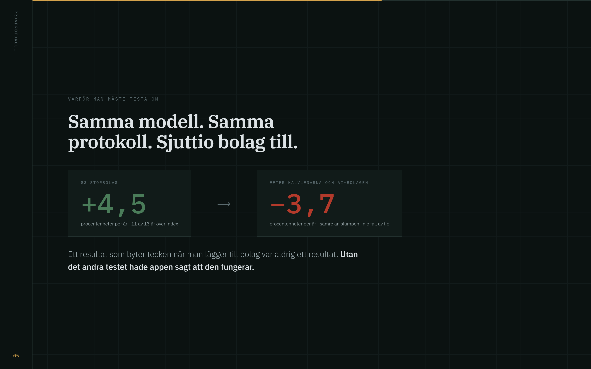

# Börscase

**Version 2.0 (2026-09-08):** nytt Analysrum på `/analys` med källor, bokslutsförändringar, ledningsmål, bevakning, värderingsscenarier och lokal analysjournal med skuggmodell. Se [ANALYSRUM.md](ANALYSRUM.md). Resultattabellen nedan beskriver version 1; den verifierar inte version 2. Huvudmodellen har körts om med rättad datahantering och ligger fortsatt efter jämförelseurvalet.


Ett räkneverktyg som letar case bland 218 börsbolag — på siffrorna **och** på vad
rapporterna faktiskt säger. Allt körs lokalt på din egen dator. Inga API-nycklar,
ingen inloggning, ingenting skickas någonstans.

**Och det viktigaste först: verktygets egen rangordning fungerar inte.** Den har
testats nio gånger mot verkligheten och fallit varje gång. Det står i appen, i
den här filen, och i koden. Läs avsnittet *Vad testerna visade* innan du använder
något av det här som beslutsunderlag.

---

## Vad det gör

| | |
|---|---|
| **Läser rapporter** | Årsredovisningar i fulltext från SEC (USA) och delårsrapporter som PDF via MFN (Sverige). Mäter hur mycket texten skrivits om sedan i fjol, tonläget, ordagranna röda flaggor och vilka riskstycken som är nya. |
| **Räknar nyckeltal** | Piotroski F, Altman Z'', Beneish M, Sloan-periodiseringar, Novy-Marx bruttolönsamhet, Greenblatts EBIT/EV, ROIC, momentum. Varje mått är publicerat av någon annan än mig, med källa i koden. |
| **Insynshandel** | Vad ledningen gör med sina egna pengar — Finansinspektionens register och SEC Form 4. |
| **Rapportkalender** | När nästa rapport kommer och hur mycket aktien brukar röra sig den dagen. |
| **Risk i kronor** | Vad en position kostar dig om bolagets värsta historiska fall upprepas. |
| **Testar sig själv** | Ur-provs-validering med point-in-time-data och nollkontroll mot slumpen. |

## Vad testerna visade

Nio signaler, prövade med samma protokoll: rangordningen sätts med *enbart* den
information som var publicerad den dagen, avkastningen mäts framåt, och allt
jämförs mot slumpmässiga poäng.

| Vad som testades | Topp − botten | p mot slumpen |
|---|---|---|
| Bara rapporttexten (Lazy Prices) | −5,0 pp | 0,757 |
| Bara finansiell styrka | −8,0 pp | 0,343 |
| Bara tillväxt | −9,1 pp | 0,460 |
| Bara värdering | −11,1 pp | 0,710 |
| Bara marknad (momentum) | −17,3 pp | 1,000 |
| Alla pelare sammanvägda | −18,3 pp | 0,890 |
| Alla pelare + rapporttext | −20,6 pp | 0,970 |
| Bara kvalitet | −25,5 pp | 0,997 |
| Insynsköp | −0,4 pp | 0,747 |

**Samtliga negativa.** De lägst rankade bolagen gick bättre än de högst rankade,
i varje enskild variant. Riktningen efter rapport testades också: 50,8 %
träffsäkerhet på 5085 rapporter — slantsingling.

Det betyder inte att måtten är påhittade. Piotroski, Altman och Novy-Marx har
femtio års forskning bakom sig. Det betyder att perioden 2013–2025 i det här
universumet gick åt andra hållet, och att tretton år är för kort att luta sig mot.

**Vad verktyget däremot är bra på:** att visa vad som står i rapporterna, hur
mycket ett bolag brukar svänga, och vilka bolag som eldar pengar de inte har.
Ingen av de sakerna kräver en prognos.

## Presentation

Åtta bilder om varför verktyget är byggt som det är, och vad testerna gav.
Öppna `presentation.html` i webbläsaren, eller `/presentation` när appen kör.
Stillbilderna ligger i [`bilder/`](bilder).



*Samma modell, samma protokoll, sjuttio bolag till. Ett resultat som byter
tecken när man lägger till bolag var aldrig ett resultat.*

## Kom igång

```
INSTALLERA.bat     en gång
SKANNA.bat         15–30 minuter första gången, sedan under två minuter
STARTA_APP.bat     öppnar http://127.0.0.1:8810
```

Kräver Python 3.10 eller senare. Fem paket installeras: yfinance, pandas, numpy,
flask, pypdf.

Nybörjare: börja i fliken **Hjälp**. Där finns arbetsgången i sju steg och en
ordlista med 55 begrepp förklarade från grunden — vad Altman Z är, vad soliditet
betyder, varför ett negativt P/E inte är billigt.

## Datakällor

| Källa | Vad | Villkor |
|---|---|---|
| [SEC EDGAR](https://www.sec.gov/edgar) | Amerikanska bokslut och rapporter | Myndighetsdata, öppen. Kräver kontaktuppgift i User-Agent, max 10 anrop/sekund |
| [MFN.se](https://mfn.se) | Svenska delårsrapporter | Öppet flöde, inget publicerat API-avtal |
| [Finansinspektionen](https://marknadssok.fi.se) | Insynshandel | Offentligt register |
| Yahoo Finance via yfinance | Kurser och marknadsdata | Inofficiellt gränssnitt utan garantier |

**Ingen hämtad data följer med i det här förrådet.** Varje installation hämtar
sitt eget, direkt från källan, i användarens eget namn. Det är avsiktligt: Yahoos
villkor tillåter inte vidaredistribution, rapporttexterna tillhör bolagen, och
insynsregistret innehåller namngivna personer.

Fyll gärna i din egen kontaktadress i `installningar.json` under `sec_kontakt`.
SEC ber om en identifierbar avsändare.

## Licens

Källkodstillgänglig, inte öppen källkod. Privat och icke-kommersiellt bruk är
tillåtet; försäljning och vidaredistribution som eget verk är det inte. Se
[LICENS.txt](LICENS.txt).

## Friskrivning

Det här är ett räkneverktyg, inte finansiell rådgivning, och ingen rekommendation
att köpa eller sälja något. Historisk avkastning är ingen garanti för framtiden.
Data kan vara fel. Enskilda aktier kan förlora hela sitt värde. Alla beslut är
dina egna.
